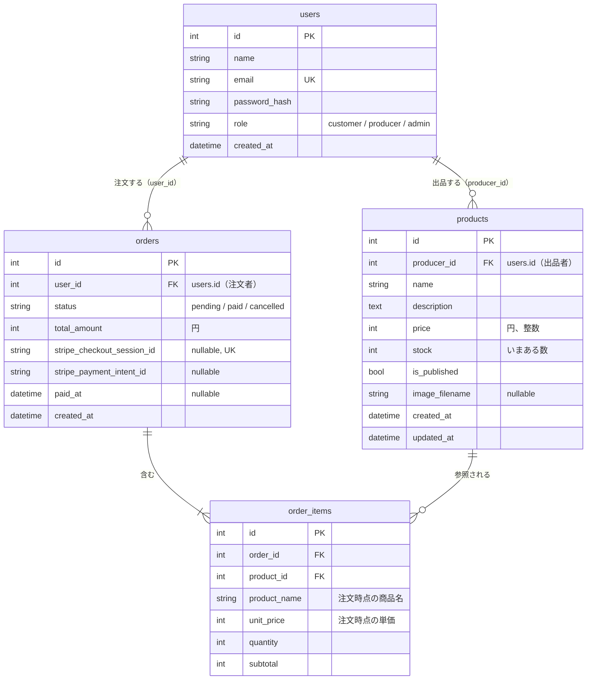

# データベース設計

テーブルは users・products・orders・order_items の4つ。カートはセッションに持つので、テーブルにしない。

## ER 図



## テーブル定義

### users（作成済み）

| カラム | 型 | 制約 | 説明 |
|---|---|---|---|
| id | Integer | PK | |
| name | String(50) | not null | 表示名。生産者の場合は農園名や屋号 |
| email | String(255) | not null, unique | 小文字にそろえて保存する |
| password_hash | String(255) | not null | `generate_password_hash` の結果。平文のパスワードは保存しない |
| role | String(20) | not null, default `customer` | `customer` / `producer` / `admin` |
| created_at | DateTime | not null | 日本時間 |

### products

| カラム | 型 | 制約 | 説明 |
|---|---|---|---|
| id | Integer | PK | |
| producer_id | Integer | FK → users.id（restrict）, not null, index | 出品した生産者 |
| name | String(50) | not null | 「ほうれん草 1束」のように、量も入れる |
| description | Text | not null, default `""` | 紹介文（2,000字まで） |
| price | Integer | not null | 円、税込み。50〜100,000（フォームで確かめる） |
| stock | Integer | not null, default 0 | いまある数。0〜999。支払いが確定したときに減らす |
| is_published | Boolean | not null, default false | 公開中か。登録したばかりの商品は非公開 |
| image_filename | String(100) | nullable | サーバーで付け直したファイル名（UUID＋拡張子）。写真がなければ NULL |
| created_at | DateTime | not null | |
| updated_at | DateTime | not null | 更新のたびに変わる（`onupdate`） |

### orders

| カラム | 型 | 制約 | 説明 |
|---|---|---|---|
| id | Integer | PK | 注文番号として画面に出す |
| user_id | Integer | FK → users.id（restrict）, not null, index | 注文した人 |
| status | String(20) | not null, default `pending` | `pending`（支払い待ち）→ `paid`（支払い済み）または `cancelled`（取り消し） |
| total_amount | Integer | not null | 合計金額（円）。サーバーで明細から計算する |
| stripe_checkout_session_id | String(255) | nullable, unique | Checkout Session の ID。注文を作った後に Stripe から受け取るので、最初は NULL |
| stripe_payment_intent_id | String(255) | nullable | 支払いが確定したときに保存する。返金（拡張 E2）で使う |
| paid_at | DateTime | nullable | 支払いが確定した日時 |
| created_at | DateTime | not null | 在庫の押さえの時間を数える起点 |

### order_items

| カラム | 型 | 制約 | 説明 |
|---|---|---|---|
| id | Integer | PK | |
| order_id | Integer | FK → orders.id（cascade）, not null, index | |
| product_id | Integer | FK → products.id（restrict）, not null, index | 売上の集計で使う |
| product_name | String(50) | not null | 注文時点の商品名 |
| unit_price | Integer | not null | 注文時点の単価 |
| quantity | Integer | not null | 1〜10 |
| subtotal | Integer | not null | `unit_price × quantity` |

## 外部キーの削除時の動き

| 関係 | 削除時 | 理由 |
|---|---|---|
| orders → order_items | cascade | 明細は注文の一部なので、注文を消すなら明細も要らない。SQLAlchemy 側でも `cascade="all, delete-orphan"` を付ける |
| products → order_items | restrict | 注文された商品が消えると、売上の記録が壊れる。注文がある商品は削除させず、非公開にしてもらう |
| users → products | restrict | 生産者が消えると、商品と売上の持ち主が分からなくなる。コアではユーザーを削除しない |
| users → orders | restrict | 注文の記録はお金の記録なので残す |

SQLite は、設定しないと restrict を確かめない（本番の MySQL は確かめる）。そのため「注文がある商品は削除できない」は、ビューの中でも確かめる。どの環境でも同じ動きとメッセージになるようにするため。

## 決めたこと

- `role` と `status` は文字列で保存し、Python 側では `StrEnum`（`Role`、`OrderStatus`）で扱う
- 金額はすべて円の整数。小数は使わない
- 文字列のカラムにはすべて長さを付ける（本番の MySQL で動かすため）
- 注文時点の商品名と単価を明細に保存する。あとで商品の名前や価格が変わっても、注文の内容は変わらない

## 在庫の方式

**B. `products.stock` は「いまある数」にして、支払いが確定したときに減らす** 方式を採る。

| 方式 | 中身 | 採るか |
|---|---|---|
| A. 毎回計算 | `stock` は「入荷した総数」。いま買える数は、総数 − 支払い済み − 支払い待ち | 採らない。生産者が収穫のたびに「これまでの合計」を計算して入力する必要がある |
| B. 支払い確定時に減らす | `stock` は「いまある数」。支払いが確定したら減らす | **採る**。生産者は収穫したら、手元の数に書き換えるだけで済む |

- 産直品は毎日収穫して在庫を足すので、生産者の感覚に合う B を採る
- B の欠点は、支払いの確定処理が2回動くと在庫が2回減ること（Stripe からの通知と、完了ページの両方で動くことがある）。これは、「`pending` のときだけ `paid` に変える」条件付きの更新で防ぐ。状態を変えられたときだけ在庫を減らす

## いま買える数の計算

```text
いま買える数 = products.stock − （状態が pending で、作成から35分以内の注文の、その商品の数量の合計）
```

- 一覧・詳細の表示と、カートから注文を作るときに使う。注文を作るときは、いま買える数を超える数量は受け付けない
- 計算は `marche/services/inventory.py` の `available_stock(product)` に置く
- 支払い待ちの注文が在庫を押さえるのは、**作成から35分** まで
  - Checkout Session の有効期限は31分にする（Stripe の最短は30分。時計のずれを見込んで1分足す）
  - 期限が切れた決済ページでは支払えないので、それより少し長い35分を過ぎたら数えない
  - 支払い画面で「戻る」を押して注文を取り消すと（`cancelled`）、35分を待たずにすぐ在庫が戻る
- 結果が0より小さくなるときは0として扱う

### 残る問題（コアでは扱わない）

- 2人が同時に最後の1個を注文すると、両方の注文が通ることがある。支払い確定時に `stock` が足りなければ0で止めるが、片方は「売れたのに在庫がない」状態になる。対策（行ロック、条件付きの減算、在庫不足なら返金）は拡張 E1 で扱う
